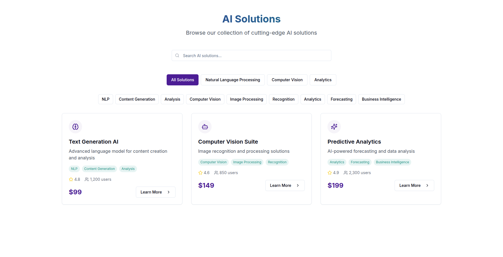

# AI Solutions Marketplace

 
Bienvenue sur **AI Solutions**, une plateforme web moderne pour explorer, filtrer et découvrir les meilleures solutions d'intelligence artificielle du marché.

## 🌐 Aperçu du Projet

Cette application propose une interface fluide et intuitive permettant de :

- Parcourir un catalogue de solutions IA classées par domaine (NLP, Computer Vision, Analytics, etc.)
- Rechercher dynamiquement des solutions avec un moteur de recherche intégré
- Filtrer par catégories grâce à des tags intelligents
- Découvrir les caractéristiques de chaque produit : prix, rating, nombre d'utilisateurs, etc.

## 🖼️ Aperçu de l’Interface


## 🧑‍💻 Développeur

Projet développé par :  
**Ismail MOUAYAHDA**  
📧 ismail.mouayahda@gmail.com

## ⚙️ Stack Technique

- **Frontend** : React + Tailwind CSS + Lucide React
- **Design** : Composants réutilisables, responsive, light UI
- **Backend** : (À intégrer ou connecter à une API)
- **Langage** : Anglais

## 🛠️ Installation

```bash
# Clone du dépôt
git clone https://github.com/ton-compte/ai-solutions-marketplace.git
cd ai-solutions-marketplace

# Installation des dépendances
npm install

# Lancer le projet
npm run dev
```

## 📌 À faire / Améliorations futures

- [ ] Connexion API dynamique pour afficher les vraies données
- [ ] Authentification utilisateur
- [ ] Système de notation/commentaires
- [ ] Paiement intégré (Stripe / PayPal)
- [ ] Dashboard admin pour la gestion des solutions IA

## 📄 Licence

Projet sous licence MIT – voir [LICENSE](./LICENSE).
```
 

## Deploy

[](https://vercel.com/new/clone?repository-url=https%3A%2F%2Fgithub.com%2Fghostland-dev%2Fai-marketplace)

Click the button to deploy your own copy on Vercel in one step.
